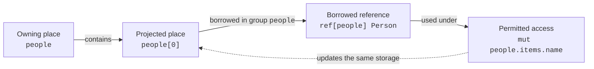
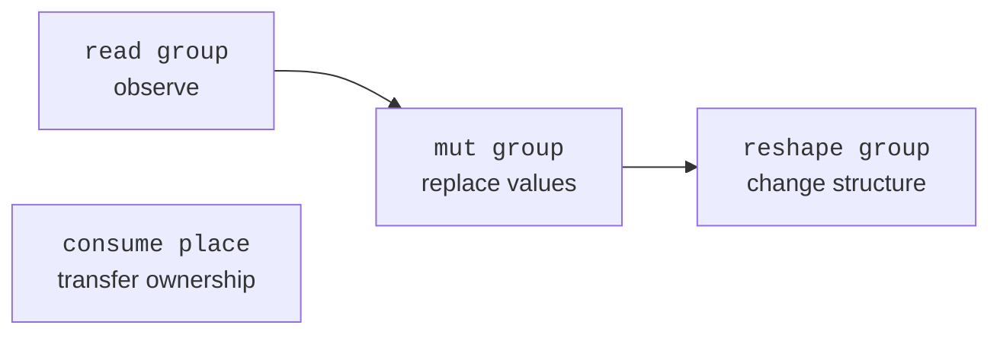
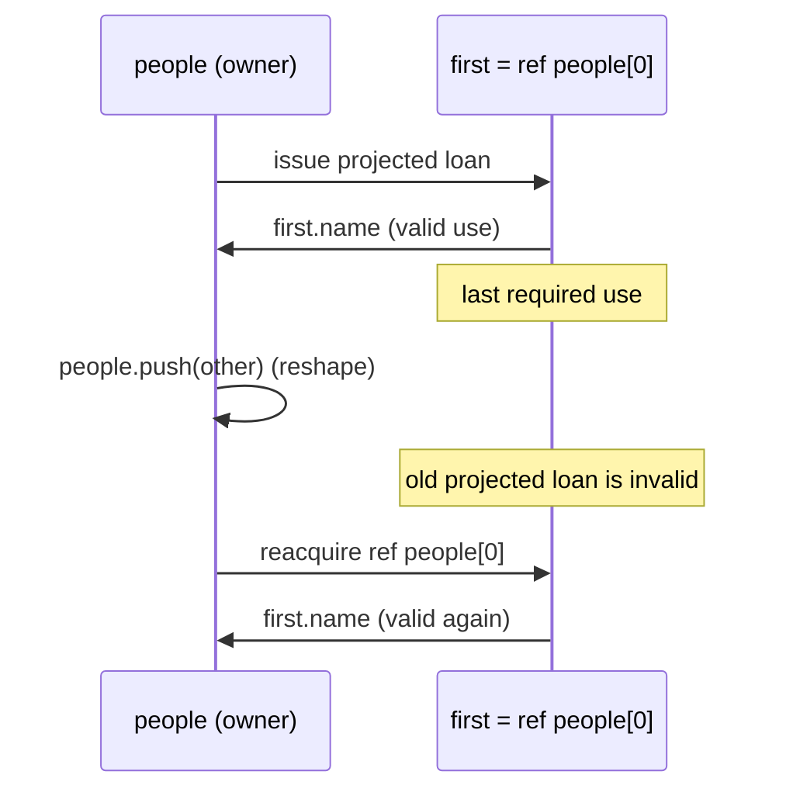

# Foster Ownership and Borrowing

Language version 24, ownership-model version 5.

This document describes Foster's ownership model, its source-level behavior, and how the compiler
implements it today. It is intentionally separate from
[`effect-derivation.md`](effect-derivation.md): ownership answers *who controls a value and when a
reference remains valid*, while effects describe *what a function may do to a borrowed group*.

See the [semantic specification](semantics.md) for the cross-language contract, rule IDs, and
explicitly tracked backend gaps. The detailed ownership rules below supplement that specification.

## Design goals

Foster uses single ownership with explicit borrowing. The model is intended to provide predictable
resource cleanup, safe mutation, transferable values for remote workers, and useful function
contracts without reproducing Rust's lifetime syntax.

The central ideas are:

- Every non-reference value has one owning place.
- Moving a value transfers ownership and invalidates the previous place.
- Copy types may be duplicated without invalidating their source.
- A reference borrows a place rather than owning its value.
- References are associated with named **groups**, not source-level lifetime parameters.
- A function signature declares the operations it may perform on each borrowed group.
- Structural mutation invalidates references into elements whose location may have changed.

## Values, locals, and places

Local values are mutable by default: `let` does not make a binding or its stored fields
immutable. Mutation requires a valid stored place and must respect ownership, live loans,
and the enclosing function's effect bounds. It does not require a separate `mut` binding
or mutable-reference type. Constants and computed properties are not assignable places.

A record field initialized with `??` is unavailable until assigned. The incomplete record must
stay in its directly bound local: whole-record reads, borrows, moves, calls, captures, and aggregate
storage require all fields to be initialized on every incoming control-flow path. Initialized
fields may be used individually. Scope exit, replacement, and failure clean up initialized fields
of an abandoned construction without calling the incomplete record's `deinit`. Once every field
is initialized, ordinary record ownership and cleanup apply. This feature does not promote storage
or change the lifetime of a reference.

Calls expose their inferred effects, or an explicitly declared upper bound checked against
the body. A mutable value does not make every call a mutation: a read-only operation keeps
its read-only contract. Explicit bounds may intentionally be broader than the body's effects.

`move` transfers ownership rather than freezing a value. The recipient may mutate its new
value; the old place cannot be used until reinitialized. Existing places passed to consuming
parameters require `move`, while copy values and fresh temporaries need no such marker.

A **value** is data such as an `Int`, `String`, list, record, closure, or remote handle. A local name
identifies a **place** that can contain a value. A declared stored field or indexed element extends
a root place, while a computed member produces a value:

```foster
people             // root place
person.name        // field place
people[index]      // indexed place
text.bytes         // computed Bytes value, not a place
```

Ownership operations apply to the root and, where supported, its projection. This distinction is
important: reading `people[index]` reads a value, while `ref people[index]` creates a loan into the
storage owned by `people`.

## Named lexical scopes

`:request { ... }` names a lexical ownership boundary. Locals declared inside it
are inaccessible outside it; remaining owned locals are destroyed in reverse binding
order at exit. Early return, loop transfers, and language failures perform ordinary
cleanup. A final expression can transfer an owned result out of the scope, including
an explicit `move` of a local. Borrowers of outer storage may leave while that storage
remains live, but references or closures borrowing a scope-local owner cannot be used
after the scope ends. These checks also apply when a borrower is assigned to an outer
binding rather than yielded as the scope's result.

The label names this lexical group. Nested blocks form nested groups, but the label
is not a runtime value or resource container. Helper calls retain their ordinary
ownership and cleanup rules; resources do not implicitly attach to a caller's group.

## Record destructuring

`let { field, other: local } = source` applies ordinary field-binding ownership to
each selected field, in pattern order, after evaluating the source once. Built-in
copy values copy; managed fields move and invalidate their source projections.
Omitted fields stay in the source. Destructuring does not implicitly invoke
`copy()`, and it cannot move fields out of a record with `deinit`.

A computed source receives a hidden owner lasting until scope exit. Selected
managed fields transfer their cleanup obligations to the new bindings, while
unselected fields remain owned by the hidden source. Record branch patterns use
the same binding and borrower propagation rules as enum payload patterns; a test
itself does not transfer ownership of its subject.

Matching through a reference preserves the subject's storage origin in payload and
field bindings. Taking `ref payload` or `ref payload.field` reborrows that storage,
including through nested enum and record patterns; it does not borrow a temporary
copy in the matching function. Reference-valued payloads retain their existing origin.
Returned references remain subject to the original owner's lifetime and invalidation rules.

## Copy and move

The built-in copy types are currently:

- `()`
- `Bool`
- `Int`
- `Float`
- `CodePoint`
- `Byte`
- `Symbol`

Other values are ownership-bearing and default to move semantics when captured. Explicit move-out
is represented in HIR as `MoveOut(expression)`. Moving from a place invalidates that place, so
subsequent reads or writes through its projections are rejected. Moving an already-computed owned
value is an explicit transfer and has no source place to invalidate. Assignment to the whole local
may reinitialize it.

`core.copy.Copy` adds explicit copying for ownership-bearing values:

```foster
import core.copy
import core.copy.Copy
import static core.copy.*
import core.drop
import core.drop.Drop


type Item = & Copy & Drop & { id: Int }
impl Item {
    func copy() -> Self { Item { id: self.id } }
    func deinit() -> () { println(self.id) }
}
```

The result spelling `Self` denotes the concrete implemented value type. A copy borrows the original and
creates an independent owner; it does not make assignment or capture implicitly copy the value.
`String` and `Bytes` support explicit copying, as do the scalar modules. A type without a matching
`copy` method remains noncopyable; `File`, for example, has no such implementation.

`deinit` is automatic, non-suspending, returns `()`, and may read its complete receiver. It runs
once when ownership ends: locals in reverse binding order, old values at replacement, consumed
parameters at function exit, and temporaries when their full expression ends. Moves transfer this
obligation, and copies own separate obligations. A parent's callback runs before its fields or
payload are released. Partial moves out of a parent with `deinit` are rejected. Calling `deinit`
directly is an error; fallible explicit closing can use a separate method returning `Result`.
Cleanup continues after errors and preserves an existing failure over a later destructor failure.
Sibling field/element destruction order is unspecified. Embedders use `vm::release_value` to
release returned values and report any destructor failure; the CLI does this automatically.

Function calls are different from closure capture: arguments are borrowed by default. A function
that takes ownership names each ownership-taking parameter with a `consume` contract, and callers
write `move` when transferring an existing place:

```foster
func inspect(message: String) -> Int {
    message.length
}

func send(message: String) -> () [consume message] {
    deliver(move message)
}

let message = "hello"
inspect(message)     // borrowed; message remains usable
send(move message)   // transferred; message is now uninitialized
```

Copy arguments (`()`, `Bool`, `Int`, `Float`, `CodePoint`, `Byte`, and `Symbol`) need no `move`, even
when the parameter has a `consume` contract. Fresh temporaries also transfer directly because there
is no source place to invalidate. Explicit `ref[group] T` remains available when a borrow must be
named, stored, returned, captured, or related to group effects; it is not required for an ordinary
call.

A borrowed parameter with a `mut` effect shares its caller place for the duration of the call. This
allows generic stateful algorithms to update readers, writers, iterators, and ordinary records
without manufacturing explicit reference types at every call boundary. Read-only borrowed
parameters may be represented by an independent read view because their contract cannot expose a
mutation; consuming parameters receive the transferred value instead.

Structural record adaptation follows the same ownership rules. Passing a wider record where a
narrower public shape is expected borrows the original value without allocating a wrapper.
Consuming through that narrower contract moves the original value and invalidates the source; the
extra runtime fields do not create a second owner.

Callable types preserve this behavior positionally. Parameters borrow unless prefixed with
`consume`:

```foster
func(String) -> ()
func(consume String) -> ()
```

When `func send(message: String) [consume message]` becomes a function value, the compiler converts
the name-based declaration into a positional `Consume` mode for parameter zero. That mode survives
closure assignment, partial application, generic instantiation, and compiler-inferred callable
erasure. Indirect
calls therefore require the same `move` as direct calls. Parameter modes describe what happens to
the argument itself; group effects continue to describe access through references.

Placeholder partial application captures its callee and every supplied operand at creation in
source order. An owned supplied place is transferred then, a copy value is copied then, and a
reference begins its loan then. Repeated calls evaluate new placeholder arguments but never
reevaluate or recapture supplied operands.

Closure captures make the choice visible:

```foster
[copy count] () -> count
[move message] () -> message
[ref person] (name: String) -> person.name = name
```

`copy` requires a copy type. `move` transfers the captured value into the closure. `ref` stores a
borrowed connection to the original place rather than a snapshot of its value. Reading through a
stored reference observes the current value in that place while the loan remains valid. Replacing,
consuming, or structurally invalidating an overlapping origin ends the loan; the reference does not
retarget to replacement storage. When no capture mode is written, type checking resolves the
pending mode to `copy` for copy types and `move` otherwise.

## References and groups

Parameters borrow by default and name their incoming storage groups:

```foster
func rename(person: Person, name: String)
    -> ()
{
    person.name = name
    ()
}
```

`person` is a parameter whose name identifies its incoming storage group.
Write `person: Person`; repeating its own group on the outer parameter type is
rejected. Explicit groups express relationships in results, nested types, or
another parameter, such as `view: ref[person] Person`.
The type annotation supplies the argument's contract, not a replacement
storage layout. A parameter such as `item: Replace` validates the
argument against `Replace` and preserves its original place. The body uses the
contract's guaranteed operations; specialization keeps the argument's layout
without copying it or borrowing a converted temporary.
The same rule applies to borrowed return contracts. A conforming returned item
keeps its original storage; the result annotation restricts accessible operations
and its group restricts provenance. That group need not contain only values with
the input's shape: a reference to a child can use its parent's incoming group.
The inferred `mut person.name` effect says the body may replace that field. A mutable reference
parameter remains connected to the caller's place, so `rename(person, "new name")` updates the
caller's `person.name`; it does not detach a callee-local copy. Group names are part of the function contract:
using a name that is not a parameter is an error in a signature. There is no separate
group-parameter declaration.

Lexical scopes define groups for local storage. Every parameter exposes an incoming storage
group, including `self`. For borrowed parameters, its storage belongs to the caller rather than
the callee's lexical frame. Names do not imply disjoint storage: arguments can alias.
A borrow created in an inner scope retains its original storage dependency. Moving an owned
result out transfers ownership and cleanup rather than permanently tying it to its defining group.
Groups are compile-time relationships, not runtime values or hidden owner objects. A reference
may escape a function only when its group is exposed by a reference, nested type, callable result,
or effect in the declared result type. A reference into a
frame-local value cannot be returned.

Borrowed results expose their input dependency in the result contract:
`func borrow(person: Person) -> ref[person] Person { ref person }`.
A consumed parameter cannot
supply escaping references because its storage belongs to the callee.

A returned reference can be passed directly to another reference parameter, either as a
call expression or through a local binding. The call retains its existing group and origin;
it does not add another reference layer or extend the origin's lifetime.

`self` is the implicit first parameter of an instance method and follows the same group
rule as every other parameter. Module and static functions cannot name that group.
An ordinary implicit receiver borrows by default and can replace the caller's whole
binding with `self = value`. Replacement and escaping borrows retain caller storage;
replacement requires `reshape self` (inferred when effects are omitted) and
invalidates overlapping borrows. `Self` remains the implemented
value type, and `self` retains its storage group.
Compiler-created closure functions derive group effects from their reference captures.
Method results may expose `ref[self] T`, including inside `Option`, to borrow from
the argument passed as `self`. Such results remain tied to that argument's lifetime; reshaping or consuming
the argument invalidates them. A structural contract retains that dependency even when
the implementation's storage fields are hidden.

### Group ownership at a glance

Explicit reference parameters retain the group named in their type. Several reference
parameters can expose a shared input group by naming one of the parameters; this is a
conservative origin contract, not a claim that the arguments are the same object. Calls
and returned values still retain every possible concrete origin.

The group name connects a reference to the places it may borrow and connects an effect to the
places it may access. It is a compile-time relationship, not another runtime owner:



In the diagram, `people` owns the storage. The group named `people` describes the relationship
between the reference and the allowed effect; it does not own or copy the `Person`.

## Group effects

Access permissions form this ordering:

```text
read < mut < reshape
```

- `read group` observes borrowed data.
- `mut group` may replace values without changing the container's structure.
- `reshape group` may structurally change a collection, potentially relocating elements.
- `consume group-or-parameter` is independent of that ordering and permits ownership to be
  extracted. Naming a parameter is the ordinary ownership-taking function contract.
- `suspend` is a separate function property, not an ownership effect.

`mut owner` also covers extracting an owned descendant when the operation replaces that part of
the owner, which is how `Iterator.next()` yields `T` while advancing its cursor. It never covers
consuming `owner` itself.

The access effects form a ladder. Each step includes the permissions to its left. `consume` sits
beside the ladder because transferring ownership is different from gaining stronger access:



The compiler derives effects from typed HIR. When a function omits an effect clause, its inferred
effects become the function contract. When a function provides an explicit bracketed clause, the
compiler requires:

```text
effects required by the body ⊆ effects declared by the signature
```

An explicit contract missing a permission is an error. An unnecessarily strong explicit
permission produces a warning. Inferred functions require neither repetition nor annotations.
Calls propagate the callee's contract after substituting parameter groups with argument origins. See
[`effect-derivation.md`](effect-derivation.md) for the derivation algorithm.

## Structural invalidation

Replacing an element and changing the shape of its owner are different operations. A reference to
`people[0]` can remain valid across ordinary reads and value mutation, but an operation such as
`people.push(...)` may reallocate the list. Foster therefore invalidates projected loans after a
reshape of their root:

```foster
let first = ref people[0]
people.push(other)
first.name // error: the projected reference was invalidated
```

Consuming the root invalidates all loans from it. The compiler permits structural mutation after a
loan's last use; it does not require the loan to remain active until the end of the lexical block.



The reshape is allowed after the old loan's last required use. Code that needs the element again
must acquire a new reference after the reshape.

Borrow provenance follows values stored in records, lists, variants, pattern bindings, closures,
and nested branch results. If any such value contains a projected reference and its origin is later
reshaped, using the aggregate or calling the closure is rejected. Named record fields and distinct
constant list indices are disjoint. Dynamic indices also become disjoint when a live branch fact
proves their stable index operands unequal; otherwise they conservatively overlap every element.

Invalidation comes from the callee's typed `reshape` and `consume` effects, including indirect and
extension calls; it is not inferred from a method's spelling. A guarded return applies effects from
its guard to both successors, while effects that occur only while evaluating its returned value do
not leak onto the continuation path.

## Borrowed list views

`List.slice(start, end)` borrows the half-open range `[start, end)` in constant time.
The result keeps the source loan alive: it cannot escape the source's lifetime, and
reshaping the source while the view or its cursor remains usable is rejected.
The view's `length` counts selected elements, and `borrow(index)` uses indexes
relative to the view, returning `None` for an invalid index.

Iterating a slice yields references to the stored elements and requires no `Copy`,
including when the list itself is borrowed from a map. A loop over a computed
slice keeps that view alive for the loop. Borrowing does not create an independent
snapshot of the elements.

Use `List.copy_slice(start, end)` for an independent owned list. This method is
available only through `impl List<T & Copy>`; an element type without the structural
`Copy` capability is rejected at compile time, even for an empty range. Both methods
assert unless `0 <= start <= end <= length`.

## Borrowed closure escape

A returned closure may own or copy its captures. A closure that borrows a local cannot outlive the
function frame:

```foster
func invalid() {
    let value = Person { name: "Ada" }
    [ref value] () -> value.name // cannot escape
}
```

A borrowed capture may escape when it originates from a reference parameter and the result type
exposes the same group:

```foster
func make_renamer(person: Person)
    -> func(String) -> () [mut person]
{
    [ref person] (name: String) -> person.name = name
}
```

The returned callable's effect contract communicates that invoking it may mutate `person`.

Borrowed values cannot be stored back into the place from which they borrow. For example, assigning
a `[ref object]` closure into a field of `object` is rejected. This prevents an object from owning a
borrower of itself and makes the runtime borrow graph non-owning and acyclic.

## Remote ownership boundary

The accepted [remote lifecycle rules](remote-semantics.md) require the remote owner to outlive its
outstanding requests. Owner destruction cancels pending work and resolves its futures as errors;
statically established violations are rejected with `E0730`. Both backends implement scoped
cancellation, and the ownership checker tracks supported completion proofs. Pending transfers
across function boundaries and unmodeled completion proofs remain conservative; see
[supported static proofs](remote-semantics.md#supported-static-proofs). The following describes
the loan boundary.

`remote value` transfers an owned object to a worker. Calls on its remote handle enqueue messages
and return futures. Ordinary explicit reference values cannot be transferred as owned mailbox
values: that would connect two independently executing ownership domains without a loan protocol.
Foster instead has two controlled read-loan forms described below.

`remote ref value` is the explicit exception for the remote receiver itself. It creates a
persistent read-only capability backed by the owner's live storage; it does not send a reference as
a mailbox argument. The owner remains free to mutate the record. Remote reads take shared access,
and owner method calls take exclusive access and commit atomically, so readers observe either the
state before or after a mutation rather than an intermediate state. A borrowed remote handle cannot
call a method with `mut self`, `reshape self`, or `consume self` effects.

Borrow-mode remote method arguments are call-scoped read-only loans over the same shared storage.
The mailbox retains the capability while queued; the worker acquires shared access for the complete
invocation and releases it when the method returns. Awaiting the future is not what releases the
loan. A consume-mode parameter instead requires `move` and crosses the mailbox as an owned value.
The compiler rejects non-read effects on borrowed remote parameters; ownership analysis prevents a
borrowed parameter from being moved into actor state or returned as an owned result.

```foster
let pending = analyzer.inspect(document)  // temporary read-only loan
analyzer.submit(move document)        // ownership transfer
```

Owned records, enums, lists, primitives, and other recursively transferable values may be sent.
The worker owns its object, so its cleanup is tied to the lifetime of the remote worker/handle rather
than to an untracked global task.

## Lifetime model

Foster has a lifetime model even though it does not expose Rust-style lifetime parameters. Groups
are the source-level vocabulary for origin and access permissions; inferred loan regions answer the
separate temporal question of how long a borrow remains usable. The compiler may represent and
solve region constraints internally, but ordinary APIs should continue to express borrowing with
groups unless a concrete relationship cannot be expressed without excessive conservatism.

Region solving is eager and intraprocedural. It runs after types, effects, parameter modes, and
closure capture modes have settled; Foster does not defer region obligations back into type
inference. A region is a set of ownership-MIR control-flow points, not necessarily one linear source
interval. Every borrow-producing MIR operation has a distinct loan identity. Forward dataflow maps
borrower contents to possible loan origins, backward dataflow identifies the points that still
require those contents, and validation rejects an overlapping invalidation on a path between loan
issuance and a required use. Public group contracts bound symbolic parameter/result provenance at
function boundaries without exposing these inferred regions in source.

A loan remains valid while its complete origin chain is live, its referenced storage identity
remains stable, and no operation has invalidated its provenance or permission. In particular, the
model must preserve these rules:

1. A loan is valid only while its owner and every component of its origin path remain alive and no
   invalidating operation has occurred.
2. Derived loans and reborrows cannot outlive their source loan. A child loan's inferred region is
   contained in every possible parent loan's region. Because Foster references are shared and
   mutation authority is expressed by effects rather than a distinct mutable-reference type, a
   live child permits reads and copies through its parent but prevents replacing, moving,
   consuming, or structurally invalidating the source path. Those restrictions end immediately
   after the child's last required use. A reborrow reached through a control-flow join may have
   multiple possible parents; all of them constrain the child.
3. Returned references and closures preserve their dependence on input groups. Calls must retain
   enough result provenance to distinguish borrowing from one input, another input, or either.
4. Control-flow joins compute loan validity precisely enough to remain useful while conservatively
   rejecting a use that is invalid on any incoming path.
5. Destruction and asynchronous suspension have defined effects on borrowed values. A loan that
   crosses `await` must refer to storage that remains live and stable through suspension, movement,
   cancellation, and resumption.
6. Loan validity and access permission remain distinct. A reference may still be live even when a
   read, mutation, reshape, move, or consume operation is not permitted at that point.
7. Provenance survives storage, projection, structural adaptation, callable erasure, partial
   application, enums, and collection insertion; none of these operations may silently turn a
   borrower into an owner-independent value.
8. Temporary values have specified destruction points, including temporaries borrowed for calls,
   guards, returned expressions, and chained method invocations.
9. Partial moves, replacement, and reshape invalidate only overlapping places when the compiler
   can establish disjointness. Moving one named field does not invalidate a loan into another.
10. Assignment cannot create an owned self-borrowing cycle or otherwise make a borrower responsible
    for keeping its own origin alive.
11. Every control transfer ends or carries loans consistently, including normal and guarded return,
    `try` error propagation, loop `break` and `continue`, loop back-edges, cancellation, and runtime
    unwinding.
12. Temporal validity alone does not permit concurrent mutation. Loans crossing task or remote
    boundaries remain subject to task ownership, overlapping-group, transfer, and synchronization
    rules.
13. Destructors cannot observe already-invalid fields, resurrect references into destroyed storage,
    or violate the language's declared destruction order.
14. Structural conformance, generic substitution, and callable variance preserve lifetime
    dependence rather than widening a borrowed value into a longer-lived contract.
15. Unsafe, host, or foreign boundaries declare whether they retain, move, invalidate, or use a
    reference asynchronously; static lifetime guarantees cannot silently assume otherwise.
16. Diagnostics retain the causal chain: where a loan originated, the operation that invalidated
    or restricted it, and the later use that required it to remain valid.

These rules do not imply source-level lifetime syntax. Surface lifetime parameters should be
considered only if real APIs expose relationships that groups plus inferred regions cannot express
clearly and precisely.

### Ownership specification status

The numbered rules above are the normative ownership contract. A production compiler must classify
each rule as enforced, deliberately conservative, or unsupported; it must not silently accept a
program outside the implemented model. The current status is:

| Rules | Status | Production requirement |
| --- | --- | --- |
| 1-4, 6-7, 9-10, 14, 16 | Enforced, with bounded comparison-based dynamic-index disjointness and conservative erased callable calls | Maintain compile-pass and compile-fail coverage for every rule and CFG shape. |
| 5, 8, 11, 13 | Enforced for named locals, consumed parameters, expression temporaries, ordinary and guarded return, assertion failure, checked arithmetic and bounds, `try`, loop and labelled-scope transfer, `await`, and cancellation | Preserve failure-edge coverage as new fallible operations are introduced; runtime cleanup invokes deinit. |
| 12 | Partial | Loans remain governed by task ownership and effects; crossing-task storage and exclusivity still require a complete specification. |
| 15 | Unsupported as a general boundary | Host and foreign interfaces must not retain references until retention contracts are implemented. |

## Compiler implementation

Types, effects, parameter modes, and captures settle before region checking.
`compiler/src/ownership/` lowers canonical places into MIR with distinct loan
identities, borrower stores, explicit invalidations, and cleanup edges.

Forward dataflow tracks possible loan contents; backward dataflow finds required
uses and demands every reborrow ancestor. Direct-call result summaries converge
to a fixed point. Indirect calls use known callable targets or fall back to the
declared reference groups. Returned references retain the argument's existing
provenance; temporary storage holding a reference is not an additional owner.
Borrowing an actual temporary owner still ends at that owner's destruction.

Aggregate stores retain field and constant-index projections. Branch and pattern
bindings carry their source provenance. Supported branch facts can establish
disjoint paths or indices; mutations discard overlapping facts. See
[analysis precision](analysis-precision.md) for the supported forms and bounds.

Each full expression owns its temporaries. Nested operands share that boundary;
a postfix transfer guard has its own. Temporaries are destroyed in reverse
creation order. Return, `try`, loop transfers, and labelled exits clean up active
temporaries and exited scopes. Consumed arguments transfer at invocation, after
later arguments have evaluated successfully. Failure edges destroy caller-owned
temporaries and locals; ordinary `Result.Error` values follow normal control flow.

`await` parks a frame without relocating its storage. Loans can cross suspension
when their origins remain live and stable. Cancellation destroys the frame and
does not resume it. Remote message restrictions still apply.

VM references hold a projection path, structural generation, and weak root-slot
connection. Nested projections flatten to the same origin. Expired or reshaped
storage fails defensively at runtime; static checks should reject such uses first.
Native references retain caller storage and follow the same source contract.
Backend cleanup details live in [VM](vm.md) and [native compilation](native.md).

See [ownership verification](ownership-verification.md) for rule witnesses,
reference-model checks, and bounded fuzzing, and [diagnostics](diagnostics.md)
for error codes.

## Diagnostics

Ownership violations are compile errors. Current errors cover:

- using an unavailable value or projecting through a moved parent (whole-local reinitialization is allowed);
- explicitly copying a non-copy value;
- returning a reference into a frame local;
- returning a borrowed closure whose group is not exposed by its result type;
- storing a borrower into the place from which it borrows;
- using a projected loan after structural mutation;
- calling a closure after mutation invalidated a captured reference;
- sending an explicit reference as an ordinary mailbox value;
- calling a mutating method through a read-only remote loan;
- mutating a borrow-mode remote method parameter;
- undeclared, missing, or invalid group effects.

Effect over-declaration is safe and therefore uses the compiler's warning channel instead.

## Current limitations and evolution

- Path and callable reasoning is bounded. Unsupported predicates, opaque factory
  targets, and excess alternatives conservatively combine possible origins; see
  [analysis precision](analysis-precision.md).
- Implicit copying remains a builtin classification. The structural `Copy`
  capability supports explicit copies without changing assignment or captures.
- Cross-task exclusivity and general retained foreign references require further
  contracts. Supported remote behavior is defined in [remote semantics](remote-semantics.md);
  supported foreign boundaries are defined in [C integration](c-integration.md).
- Arbitrary cyclic owned graphs and process-fatal cleanup guarantees remain outside
  the implemented model. Planned extensions are tracked in the [roadmap](roadmap.md).

### Non-returning expressions

`panic(message)` and synchronous calls returning `Never` have no successful continuation.
Ownership MIR terminates those paths after accounting for owned temporaries and locals.
Runtime failure cleanup releases callee and caller frames using the same contract as failed
assertions. `Never` does not permit manufacturing values, bypassing moves, or returning loans
whose origins have ended. `try` propagates enum outcomes and cannot catch a panic.
